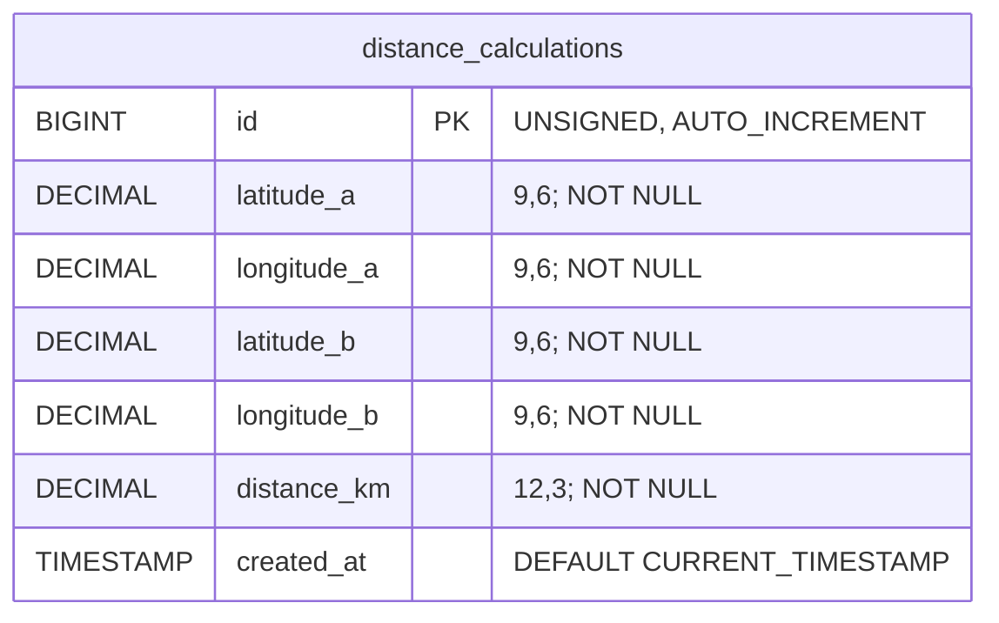

# Geographic Distance Calculator

A simple PHP web application that calculates the approximate distance between two geographic locations using their latitude and longitude coordinates.

## Features

- Enter latitude and longitude for **Location A** and **Location B**.
- Calculate the distance in **kilometres (km)** using the Haversine formula.
- Validate coordinates and show messages for invalid or missing inputs.
- Display the calculated distance together with the coordinates entered for both locations.
- Select **"How was this distance calculated?"** after a successful calculation to see an easy-to-understand explanation of the calculation steps.
- Use a simple, responsive layout.
- Save calculation details in MySQL using a stored procedure.

## Technologies Used

- **HTML, CSS and JavaScript** – User interface
- **PHP** – Backend, validation and distance calculation
- **MySQL 8.4** – Database
- **MySQL stored procedure** – Save calculation records
- **XAMPP (Apache)** – Local web server
- **MySQL Workbench** – Database setup and management

## Project Structure

```text
distance-calculator/
├── index.php
├── includes/
│   ├── database.php
│   └── distance.php
├── assets/
│   └── style.css
├── config/
│   └── database.example.php
├── database/
│   └── distance_calculator.sql
├── .gitignore
└── README.md
```

> File locations above are a guide. Keep the actual filenames and folders used in your project, and update this section if they differ.

## Database Structure

The application uses one table, `distance_calculations`, to store the coordinates, calculated distance and creation time. Since the database has only one table, there are no relationships between tables to show.



The `save_distance_calculation` stored procedure is used to save a calculation record. The database creation script is provided in `database/distance_calculator.sql`.

> Check that the table name, column names, data types and stored procedure name match your final exported SQL file.

## Installation and Setup

### 1. Requirements

Install:

- XAMPP (for Apache and PHP)
- MySQL Server 8.4
- MySQL Workbench (to import and inspect the database)

### 2. Copy the project

Place the project folder inside the XAMPP `htdocs` directory:

```text
C:\xampp\htdocs\distance-calculator\
```

### 3. Import the database

1. Start *.
3. Open `database/setup.sql` in Workbench.
4. Execute the script to create the required database objects.

**Note:** A SQL export may also contain saved calculation records. Check the SQL file if you need to submit a database without sample data.

### 4. Configure the database connection

The project includes `config/database.example.php` as a sample configuration file. **Do not include your real database password in the repository.**

1. Copy the sample configuration to the private location below:

   ```text
   C:\xampp\distance-calculator-config.php
   ```

2. Edit the copied file and enter your local MySQL host, port, database name, username and password.
3. Keep this real configuration file **MySQL Server 8.4**.
2. Open **MySQL Workbench** and connect to your local MySQL server*outside the project folder**. The PHP database connection code should load the private file from this location.

Example of the configuration values (the format must match what your `includes/database.php` expects):

```php
<?php
return [
    'host' => '127.0.0.1',
    'port' => 3306,
    'database' => 'distance_calculator',
    'username' => 'YOUR_MYSQL_USERNAME',
    'password' => 'YOUR_MYSQL_PASSWORD',
];
```

The `.gitignore` file also excludes local credential files and `.env` files from new Git commits. **Never commit real passwords or secrets.**

### 5. Start and open the application

1. Start **Apache** in the XAMPP Control Panel.
2. Make sure **MySQL Server 8.4** is running.
3. Open this URL in your browser:

   ```text
   http://localhost/distance_calculator/
   ```

**Note:** If you use a separately installed MySQL 8.4 server, you do not need to start XAMPP's MySQL/MariaDB service.

## How to Use

1. Enter the latitude and longitude for Location A.
2. Enter the latitude and longitude for Location B.
3. Click **Calculate Distance**.
4. View the distance in kilometres and the coordinates used for the calculation.
5. Click **How was this distance calculated?** to view the explanation and calculation steps.

## How the Distance Is Calculated

The application uses the **Haversine formula**, which estimates the shortest distance along the Earth's surface between two points.

The calculation:

1. Converts the entered coordinates from degrees into radians.
2. Finds the difference between the two latitudes and longitudes.
3. Applies the Haversine formula to determine the angle between the locations.
4. Uses the Earth's approximate radius to calculate the distance in kilometres.

The **How was this distance calculated?** feature explains these steps in a way that is easier for non-technical users to understand.

**Important:** This result is an approximate straight-line distance over the Earth's surface, **not** driving or road distance.

## Security Note

- `config/database.example.php` contains placeholders only and can be shared.
- `C:\xampp\distance-calculator-config.php` contains your real local credentials and should remain private.
- Do not add real passwords, secret keys or private configuration files to GitHub or the submission ZIP.
